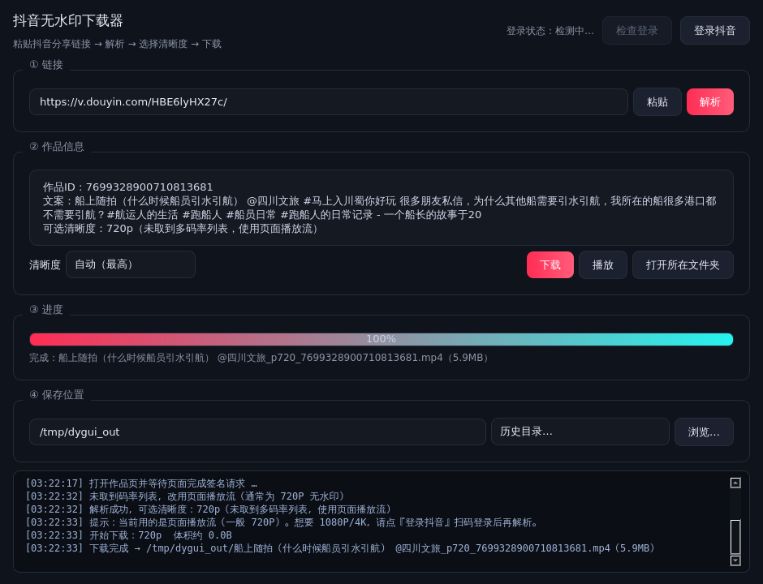

# 抖音无水印下载器（桌面版 v2.0）

一个 Windows 桌面小工具：粘贴抖音分享链接 → 解析 → 选清晰度 → 下载无水印 mp4。



## 为什么重写

旧的纯 HTTP 解析（`douyin_dl.py`）已经失效：抖音现在对分享页和 `aweme/detail` 接口都加了
**a_bogus / x-secsdk-web-signature 签名 + 风控**，纯脚本请求一律 403；yt-dlp 现在也报
`Fresh cookies are needed`。

新方案让**本机已经装好的 Edge / Chrome 自己去发那条合法请求**（浏览器会完成签名），
程序通过 DevTools 协议把结果取出来，再直连 CDN 下载：

```
启动本机 Edge/Chrome（独立 profile，可复用登录态）
   └─ 打开 https://www.douyin.com/video/{id}
        ├─ 页面自己发出带签名的 aweme/detail 请求  ──┐
        │                                            │
        └─ 程序从 performance 里取出这条"已签名 URL" ─┘
                └─ 在页面内 fetch 重放 → 拿到全部码率列表（含 1080P/4K）
                        └─ 选档 → 直连 douyinvod CDN 下载无水印 mp4
```

如果重放拿不到数据（未登录 / 被风控），自动降级为**页面播放流兜底**：从页面已加载的
媒体流里挑码率最高的一条下载，一般得到 720P 无水印。

## 用法

1. 双击 `抖音视频下载器.exe`（或 `python app.py`）。
2. 把抖音分享链接粘到输入框——**可以直接粘整段分享文字**（如「9.43 复制打开抖音… https://v.douyin.com/xxxx/ …」），
   程序会先跟随短链跳转解析出作品 ID，再解析作品。
3. 选清晰度，点 **下载**。完成后可 **播放** / **打开所在文件夹**。
4. 保存位置默认是「下载」文件夹，选过的目录会进「历史目录…」下拉。
5. 右上角常驻 **登录状态**（启动时自动检测，也可点『检查登录』重查）：
   `已登录（昵称）` 为绿色，`未登录` 为橙色。

遇到「解析失败 / 被风控 / 只有 720P」：点 **登录抖音**，在弹出的浏览器窗口里扫码登录，
登录后**不用关窗口**，直接点『检查登录』确认变成绿色即可（登录状态存在独立浏览器 profile 里，长期有效）。

## 命令行（可选）

```bat
抖音视频下载器.exe --cli "https://v.douyin.com/xxxxxxx/" -q 1080p -o D:\视频
抖音视频下载器.exe --status      :: 只看登录状态
抖音视频下载器.exe --selftest    :: 运行库自检（不联网）
```

## 自己打包 exe

双击 **`一键打包exe.bat`**（需本机装有 Python 3.10+，安装时勾选 Add to PATH）。
脚本会自动装 PySide6 + PyInstaller 并产出 `抖音视频下载器.exe`（约 80–150MB，双击即用，
目标机器不需要装 Python）。

容器/CI 里打包见 `.github/workflows/build-exe.yml`。

## 已知限制（如实说明）

- **只能在 Windows/有桌面环境的机器上跑**：它要启动一个真实浏览器。
- 免登录时通常只能拿 720P（页面播放流）；1080P/4K 需要登录态，或重放 detail 接口成功。
- 抖音随时会改风控；改到连浏览器都不给数据时，需要更新本工具的取数逻辑。
- 只支持视频作品，**图文/图集作品不支持**。
- 下载失败常见原因：作品已删/私密、链接不是作品链接、网络不通。

## 文件说明

| 文件 | 作用 |
|---|---|
| `app.py` | 主程序：PySide6 图形界面 + 命令行模式 |
| `engine.py` | 浏览器引擎：启动 Edge/Chrome、取签名请求、解析码率、下载 |
| `cdp.py` | 极简 Chrome DevTools Protocol 客户端（纯标准库 WebSocket，无第三方依赖） |
| `dycore.py` | 公共小工具（文件名清洗、体积格式化、旧版纯 HTTP 解析备查） |
| `_gui_smoke.py` | 自动化冒烟测试（离屏跑完整解析+下载并截图） |
| `一键打包exe.bat` | 一键打成单文件 exe |

## 许可证

个人自用工具。请只下载你有权保存的内容，遵守平台规则与版权法律。
